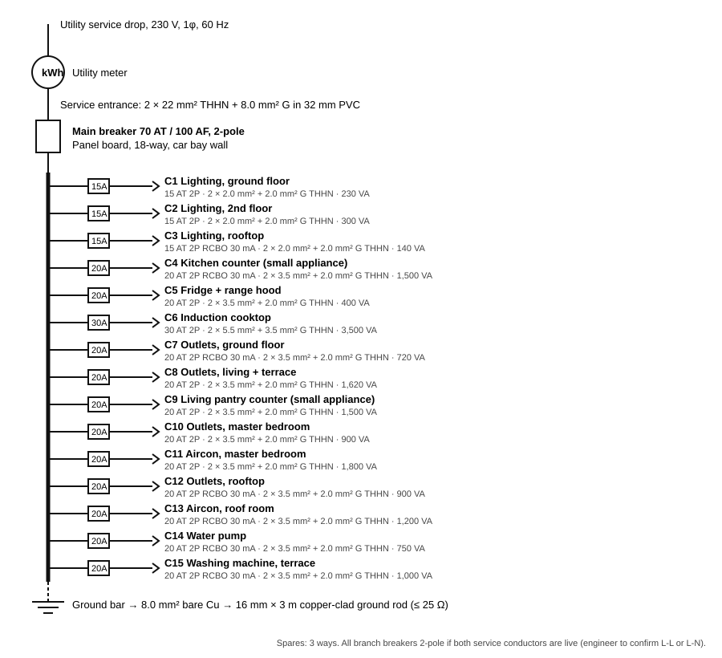

This set is a draft prepared for the owner. It becomes a design only once a licensed PEE reviews it, makes any corrections and signs it. Where this page and the engineer disagree, the engineer wins.

## Title block

| | |
|---|---|
| Project | Residential renovation, whole-house rewiring (2 storeys + rooftop room) |
| Owner | Navarro family |
| Location | (on file with the owner) |
| Service | 230 V, 1-phase, 60 Hz, 2-wire + ground |
| Sheets | E-1 Single-line diagram · E-2 Load schedule · E-3 Demand and main sizing · E-4 Panel schedule · E-5 Device layout ([floor plans](electrical-layout-v1.html)) |
| Revision | Draft A, 20 Nov 2026 |
| Prepared by | Owner (draft for review) |
| Reviewed and designed by | Name: ______________________ PEE / PRC Lic. No.: __________ PTR No.: __________ |
| Signature and seal |   ______________________ Date: __________ |

## E-1 Single-line diagram

## E-2 Load schedule

All conductors are copper THHN/THWN-2 in PVC conduit (UV-rated or IMC where exposed outdoors). VA values are design estimates for checking against nameplates. Voltage drop is for the full load at the far end, at 230 V.

| Ckt | Description | Serves | Outlets | VA | Amps | Breaker | Conductors | Conduit | Length (m) | Volt drop |
|---|---|---|---|---|---|---|---|---|---|---|
| 1 | Lighting, ground floor | Car bay (2), outside front, dining + pendant, stair, kitchen (2) + motion-sensor counter strip, T&B light + exhaust fan | – | 230 | 1.0 | 15 A, 2P | 2 × 2.0 mm² + 2.0 mm² G | 20 mm | 25 | 0.2% |
| 2 | Lighting, 2nd floor | Terrace, living (3) + 2 pendants + ceiling fan, annex stair, bedroom (2) + 2 bedside pendants + exhaust fan | – | 300 | 1.3 | 15 A, 2P | 2 × 2.0 mm² + 2.0 mm² G | 20 mm | 25 | 0.3% |
| 3 | Lighting, rooftop | Roof room (2), roof T&B light + exhaust fan, stair landing, outside WP light | – | 140 | 0.6 | 15 A, 2P RCBO 30 mA | 2 × 2.0 mm² + 2.0 mm² G | 20 mm | 40 | 0.2% |
| 4 | Kitchen counter (small appliance) | 4 counter outlets (incl. bar counter) + high wall-fan outlet | 5 | 1,500 | 6.5 | 20 A, 2P RCBO 30 mA | 2 × 3.5 mm² + 2.0 mm² G | 20 mm | 15 | 0.4% |
| 5 | Fridge + range hood | Fridge outlet (1.0–1.2 m) + hood outlet (1.9 m) | 2 | 400 | 1.7 | 20 A, 2P | 2 × 3.5 mm² + 2.0 mm² G | 20 mm | 15 | 0.1% |
| 6 | Induction cooktop | Built-in 2-burner induction, 30 A outlet/isolator | 1 | 3,500 | 15.2 | 30 A, 2P | 2 × 5.5 mm² + 3.5 mm² G | 25 mm | 15 | 0.7% |
| 7 | Outlets, ground floor | Car bay (1 WP + 1), dining (2) | 4 | 720 | 3.1 | 20 A, 2P RCBO 30 mA | 2 × 3.5 mm² + 2.0 mm² G | 20 mm | 20 | 0.3% |
| 8 | Outlets, living + terrace | Living (8, incl. TV wall and sofa USB) + terrace (1) | 9 | 1,620 | 7.0 | 20 A, 2P | 2 × 3.5 mm² + 2.0 mm² G | 20 mm | 25 | 0.8% |
| 9 | Living pantry counter (small appliance) | 3 counter outlets, router/ONT | 3 | 1,500 | 6.5 | 20 A, 2P | 2 × 3.5 mm² + 2.0 mm² G | 20 mm | 25 | 0.7% |
| 10 | Outlets, master bedroom | 5 outlets (bedsides with USB, desk, wardrobe) | 5 | 900 | 3.9 | 20 A, 2P | 2 × 3.5 mm² + 2.0 mm² G | 20 mm | 30 | 0.5% |
| 11 | Aircon, master bedroom | 1.5 HP inverter split, outlet at 2.0 m | 1 | 1,800 | 7.8 | 20 A, 2P | 2 × 3.5 mm² + 2.0 mm² G | 20 mm | 30 | 1.1% |
| 12 | Outlets, rooftop | Roof room (4) + outside WP (1) | 5 | 900 | 3.9 | 20 A, 2P RCBO 30 mA | 2 × 3.5 mm² + 2.0 mm² G | 20 mm | 40 | 0.7% |
| 13 | Aircon, roof room | Window-type aircon (assumed 1.0 HP), outlet at 1.8 m | 1 | 1,200 | 5.2 | 20 A, 2P RCBO 30 mA | 2 × 3.5 mm² + 2.0 mm² G | 20 mm | 40 | 0.9% |
| 14 | Water pump | 0.5 HP constant-pressure inverter pump, WP outlet at 1.2 m by the tank | 1 | 750 | 3.3 | 20 A, 2P RCBO 30 mA | 2 × 3.5 mm² + 2.0 mm² G | 20 mm | 5 | 0.1% |
| 15 | Washing machine, terrace | Dedicated IP44 outlet at 1.2 m beside the washer tray | 1 | 1,000 | 4.3 | 20 A, 2P RCBO 30 mA | 2 × 3.5 mm² + 2.0 mm² G | 20 mm | 25 | 0.5% |

**Connected load:** 16,460 VA. Every branch is within the 3% voltage-drop guide; the main feeder is short (panel next to the meter wall).

## E-3 Demand and main breaker sizing

Standard method for dwellings (PEC Article 2.20).

| Step | Basis | VA |
|---|---|---|
| A. Lighting (circuits 1–3) | LED fixtures, nameplate estimate | 670 |
| B. General outlets (circuits 7, 8, 10, 12) | 180 VA per outlet, 23 outlets | 4,140 |
| C. Small appliance (circuits 4, 9) | 1,500 VA per circuit | 3,000 |
| A + B + C | | 7,810 |
| Demand on A + B + C | First 3,000 VA at 100%, rest at 35% | 4,684 |
| D. Fixed appliances (fridge + hood, pump, washer) | Fewer than 4 appliances, 100% | 2,150 |
| E. Induction cooktop | Assumed 3.5 kW nameplate, 100% | 3,500 |
| F. Aircons (circuits 11, 13) | 100% | 3,000 |
| G. Largest motor | 25% of the 1.5 HP aircon compressor | 450 |
| **Total demand** | | **13,784** |
| **Demand current at 230 V** | | **59.9 A** |

**Main breaker:** the demand is about 60 A, so a 60 A main has no margin. This set proposes a **70 AT / 100 AF 2-pole main** with **2 × 22 mm² THHN** service entrance conductors and an **8.0 mm²** equipment ground, in 32 mm conduit. Check with the utility that the meter and service drop allow 70 A before buying the panel.

**Grounding:** a ground bar in the panel, an 8.0 mm² bare copper grounding electrode conductor and a 16 mm × 3 m copper-clad ground rod, target 25 Ω or less (add a second rod if not met). Every circuit carries its own green equipment grounding conductor.

## E-4 Panel schedule

Panel: 18-way plug-in, 70 A main, surface mounted on the car bay wall (the wall on the left when entering from the street), top at about 1.8 m, 1 m clear working space in front.

| Way | Circuit | Description | Breaker | Wire |
|---|---|---|---|---|
| 1 | C1 | Lighting, ground floor | 15 AT, 2P | 2.0 mm² |
| 2 | C2 | Lighting, 2nd floor | 15 AT, 2P | 2.0 mm² |
| 3 | C3 | Lighting, rooftop | 15 AT, 2P RCBO 30 mA | 2.0 mm² |
| 4 | C4 | Kitchen counter (small appliance) | 20 AT, 2P RCBO 30 mA | 3.5 mm² |
| 5 | C5 | Fridge + range hood | 20 AT, 2P | 3.5 mm² |
| 6 | C6 | Induction cooktop | 30 AT, 2P | 5.5 mm² |
| 7 | C7 | Outlets, ground floor | 20 AT, 2P RCBO 30 mA | 3.5 mm² |
| 8 | C8 | Outlets, living + terrace | 20 AT, 2P | 3.5 mm² |
| 9 | C9 | Living pantry counter (small appliance) | 20 AT, 2P | 3.5 mm² |
| 10 | C10 | Outlets, master bedroom | 20 AT, 2P | 3.5 mm² |
| 11 | C11 | Aircon, master bedroom | 20 AT, 2P | 3.5 mm² |
| 12 | C12 | Outlets, rooftop | 20 AT, 2P RCBO 30 mA | 3.5 mm² |
| 13 | C13 | Aircon, roof room | 20 AT, 2P RCBO 30 mA | 3.5 mm² |
| 14 | C14 | Water pump | 20 AT, 2P RCBO 30 mA | 3.5 mm² |
| 15 | C15 | Washing machine, terrace | 20 AT, 2P RCBO 30 mA | 3.5 mm² |
| 16–18 | Spare | – | – | – |

## E-5 Device layout

Positions of every light, switch, outlet, the panel, the network points and the main conduit route are on the [electrical layout](electrical-layout-v1.html) (ground floor, 2nd floor and rooftop list). Mounting heights: switches 1.2–1.4 m, general outlets 0.3 m, kitchen counter outlets 1.1 m, aircon outlets 1.8–2.0 m, pump and washer outlets 1.2 m, range hood 1.9 m.

## Design notes for the engineer

- **Wiring method:** existing embedded conduits and boxes are reused where sound, with all wire replaced. New runs go above the new hung ceilings (PVC panels on metal furring in the living room, bedroom, kitchen and dining; gypsum on the terrace). The car bay has a bare slab, so its 5 m trunk is painted surface conduit. Riser to the 2nd floor goes up the stairwell wall (no slab holes). The roof feed goes through the wall above the terrace slider and up under the terrace roof.
- **Lighting control:** every light is on a Tuya smart touch switch, **no-neutral type** with the bypass capacitor across the first fixture of each switched line. One switch per light, no two-way switching. Deep boxes throughout. Please confirm no-neutral switching is acceptable, or require a neutral in every switch box.
- **Wet and outdoor locations:** RCBO 30 mA on the rooftop circuits, kitchen counter, ground floor outlets (car bay), water pump and the terrace washer. Outdoor and washer outlets IP44 or better with covers.
- **Network:** Cat6 in separate conduit from power, router at the 2nd floor pantry counter, 3 wired mesh nodes.
- **Heavy fixtures:** the living room ceiling fan and the pendants hang from the slab on anchored hooks, not from the ceiling panels.

## Assumptions to confirm

| Item | Assumed here | Needed |
|---|---|---|
| Induction cooktop | 3.5 kW, 2 burners | Nameplate kW of the chosen model; change circuit 6 if above 3.5 kW |
| Bedroom aircon | 1.5 HP inverter split, 1,800 VA | Nameplate |
| Roof room aircon | 1.0 HP window type, 1,200 VA | Model and nameplate |
| Water pump | 0.5 HP inverter, 750 VA | Nameplate |
| Washing machine | 1,000 VA, no heater | Nameplate (raise if it heats water) |
| Service | 230 V, 2-wire; utility allows 70 A | Utility check; whether the two service conductors are L-L or L-N |
| Switches | No-neutral smart switches | Engineer's acceptance |

<!-- Rules: no city name, street address or GPS coordinates on any page. Tag every price Local or Online. -->
