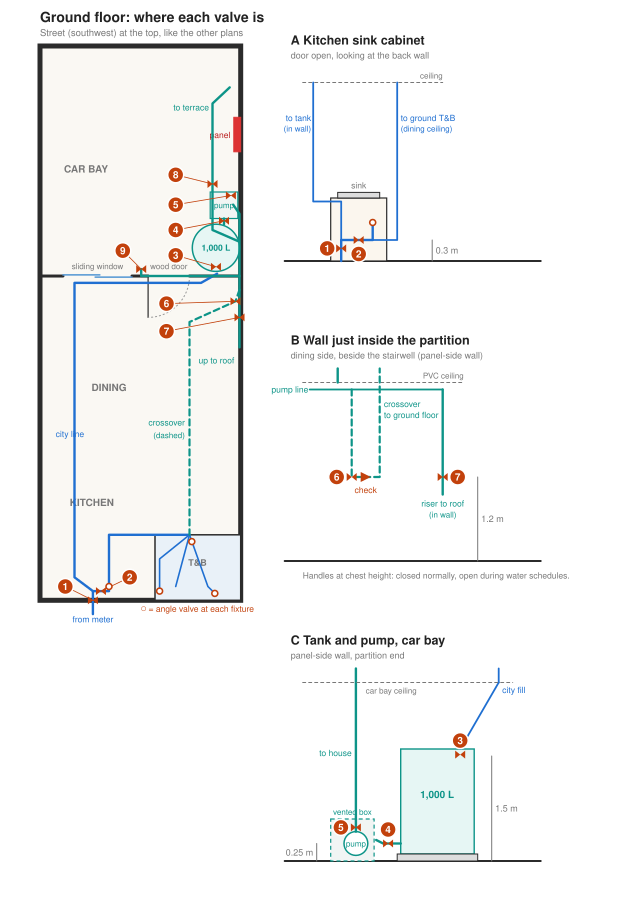

## Where each valve is

Blue is city water. Green is tank water from the pump. The dashed green line is the crossover.

## Valve list

| # | Valve | Where | Height | When you touch it |
|---|---|---|---|---|
| 1 | Main shut-off (ball valve) | Kitchen sink cabinet, where the city line comes in | 0.3 m | Leaks or repairs: shuts off the whole house |
| 2 | Check valve, ground floor | Kitchen sink cabinet, next to 1 | 0.3 m | Never; stops tank water flowing back into the city line |
| 3 | Float valve (tank fill) | Top of the 1,000 L tank, car bay | 1.5 m | Never; fills the tank by itself. Check once a year |
| 4 | Tank outlet / pump inlet shut-off | Inside the pump box (lift-off lid) | 0.25 m | Pump service only |
| 5 | Pump check valve + outlet shut-off | Inside the pump box | 0.5 m | Pump service only |
| 6 | Crossover shut-off + check valve | Wall just inside the partition, dining side, by the stairwell | 1.2 m | Open during water schedules, close when city water is back |
| 7 | Roof riser shut-off | Same wall, beside 6 | 1.2 m | Repairs on the roof T&amp;B or rooftop faucet |
| 8 | Terrace faucet shut-off | Exposed pipe on the car bay ceiling | ceiling | Rarely; step stool |
| 9 | Car bay hose bib | Partition, car side, between the window and the door | 0.6 m | Washing the car (tank water) |
| ○ | Angle valves | Under each kitchen and T&amp;B fixture | 0.2–0.5 m | Fixture repairs |

Upstairs (not drawn): the terrace hose faucet at 0.6 m on the terrace side wall, the rooftop faucet with its own shut-off at 0.6 m outside the roof room, and angle valves under the roof T&amp;B fixtures.

## Notes

- No valve sits above the PVC ceilings, so no access hatch is needed.
- Normal day: 6 closed, everything else open. During a water schedule: open 6, then close it when city water is back.
- Heights are to the valve handle, measured from the finished floor.
- Full layout: [plumbing plan](plumbing-layout-v1.html). Costs: [plumbing materials](plumbing-materials.html).

<!-- Leave a blank line before and after every table, or the site shows it as plain text. -->
<!-- Rules: no city name, street address or GPS coordinates on any page. Tag every price Local or Online. -->
