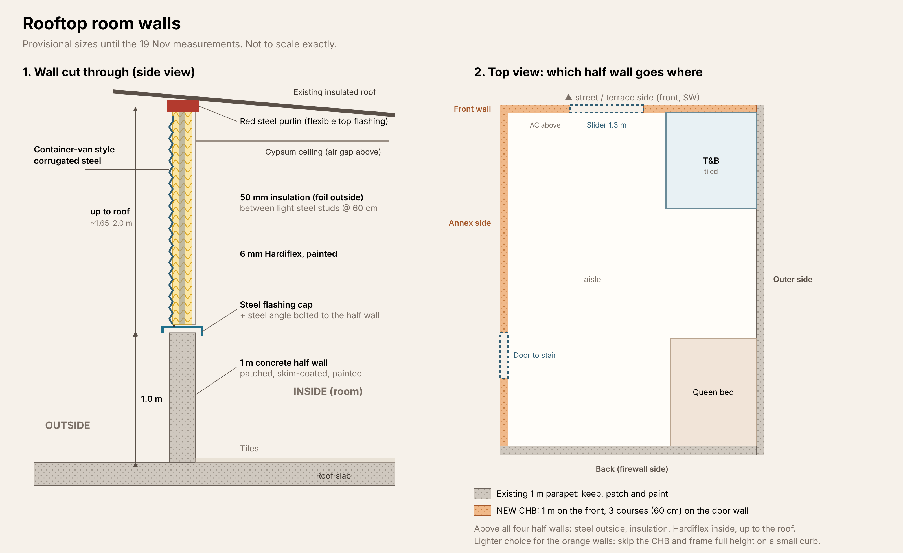

All prices are online estimates (Sept–Nov 2026) and need local quotes. Sizes are provisional until the site measurements on 19 Nov: room about **4.4 m wide × 5.9 m deep**, walls up to the roof (about 2.65 m at the front, about 3.0 m at the back).

## Walls: decided

**A 1 m concrete half wall all round, with a framed wall above it up to the roof:** container-van style steel outside, insulation in between, painted Hardiflex inside, all on a light steel frame. Decided 18 Nov.

Above the half wall, from the outside in:

1. **Container-van style steel wall:** pre-painted steel sheets in a deep trapezoidal corrugation (the container-van look), about 0.4–0.5 mm, laid vertically and screwed to the frame. No outside painting. Real container-gauge steel (about 1.6 mm, welded) would be several times heavier and costlier, so this uses the look, not the gauge.
2. **Insulation core:** 50 mm foil-faced rockwool or glasswool between the frame members, foil toward the steel to reflect heat. Every wall is insulated, including the sun-facing front (SW), outer side and back.
3. **Frame:** light steel studs or C-purlins at 60 cm, fixed to the columns, a steel angle bolted on top of the half wall, and the purlins at the top.
4. **Inside:** 6 mm Hardiflex, joints taped, puttied and painted. In the T&B: 12 mm fibre-cement board, waterproofed and tiled (see T&B build below).

**The 1 m half wall:**

- **Back and outer side:** use the existing concrete parapets. Patch and skim-coat the inside face, then paint.
- **Front wall and annex-side wall (confirmed 18 Nov):** there's no parapet on these lines, so a new 1 m half wall in 4″ CHB, plastered both sides, goes on these two walls (about 8 m, leaving out the slider and door openings). The look is the same all round and floor-level water never reaches the steel frame.
- **Top of the half wall:** a steel flashing cap over the joint, so rain running down the steel never gets into the top of the concrete.

**Other details:**

- **Top:** stops at the red steel purlins with a flashing that lets the roof move.
- **Weight:** framed walls about 20 kg per m² (about 0.7 t in all). The new CHB half walls add about 1.6 t.
- **Hanging things:** Hardiflex alone won't hold heavy items. Mark the stud lines, or add plywood backing behind the desk, TV and storage-wall positions before boarding. Below 1 m you can drill straight into the concrete.

## How the walls compared

For about 43 m² of new outside wall.

| | CHB 4″, plastered | AAC lightweight block | Fibre-cement both sides on steel studs | Container-van steel + insulation + Hardiflex (chosen) |
|---|---|---|---|---|
| Weight per m² | ~200 kg | ~90 kg | ~28 kg | ~20 kg |
| Total wall weight | ~8.6 t | ~3.9 t | ~1.2 t | ~0.9 t |
| Heat | Poor: soaks up sun, warms the room at night | Good | Very good with insulation | Very good: foil faces the sun |
| Time to build | 2–3 weeks | 1.5–2 weeks | About 1 week | About 1 week |
| Source | Online | Online | Online | Online |

## Cost by section

| Section | Low (₱) | High (₱) | Source |
|---|---|---|---|
| Walls: half walls, framed walls above (container-van steel, insulation, Hardiflex), T&B walls, paint | 84,550 | 130,250 | Online |
| Floor (porcelain tiles) | 16,500 | 28,700 | Online |
| Ceiling with vents | 21,000 | 33,000 | Online |
| Doors and windows | 34,500 | 62,000 | Online |
| T&B waterproofing, tiles, fixtures | 29,650 | 58,900 | Online |
| **Total before contingency** | **186,200** | **312,850** | |
| **With 10% contingency** | **204,820** | **344,135** | |

**Not included:** the window aircon unit (about ₱18,000–26,000 for a 1 HP inverter, Online), bed, desk and storage-wall carpentry, wiring and the T&B exhaust fan (on the [electrical materials page](../house/electrical-materials.html)), pipes, core drilling and the raised T&B floor (on the [plumbing materials page](../house/plumbing-materials.html)), and engineer fees.

## Walls

The framed wall above the 1 m half walls covers about 35 m² after the door, slider and window openings.

| Item | Qty | Low (₱) | High (₱) | Source |
|---|---|---|---|---|
| New 1 m CHB half wall, plastered both sides, front and annex-side walls, dowelled to the slab | ~8 m² | 10,500 | 14,800 | Online |
| Existing parapets (back, outer side): patch and skim coat inside; paint all half walls (primer + paint) and labour | ~27 m² | 6,400 | 10,350 | Online |
| Light steel frame (studs or C-purlins at 60 cm), angles on the half walls, frames around openings | 35 m² | 8,750 | 14,000 | Online |
| Container-van style corrugated steel sheet, pre-painted, 0.4–0.5 mm (with laps and waste) | 40 m² | 14,000 | 22,000 | Online |
| Breathable wrap behind the steel | 35 m² | 1,750 | 3,150 | Online |
| Insulation 50 mm, foil-faced rockwool or glasswool | 35 m² | 4,200 | 7,700 | Online |
| Hardiflex 6 mm inside (with waste) | 38.5 m² | 7,150 | 9,650 | Online |
| Flashings (incl. half-wall caps), corner trims, screws, joint tape, compound, sealant | 35 m² | 5,950 | 9,750 | Online |
| Labour (frame, steel, insulation, boards) | 35 m² | 14,000 | 21,000 | Online |
| T&B inner walls: 3 courses of 4″ CHB (about 60 cm), plastered | ~1.6 m² | 1,800 | 2,500 | Online |
| T&B inner walls above the block: steel studs, 12 mm fibre-cement both sides, labour | ~4.7 m² | 3,750 | 5,200 | Online |
| T&B outer walls above the 1 m half wall: 12 mm fibre-cement instead of Hardiflex on the inside face | ~4.6 m² | 1,000 | 1,600 | Online |
| T&B door frame, head and step curb | lot | 800 | 1,200 | Online |
| Hardiflex paint: putty, primer, latex, and painting labour | ~41 m² | 4,500 | 7,350 | Online |
| **Subtotal** | | **84,550** | **130,250** | |

Inside the T&B, the concrete at the bottom and the fibre-cement above are waterproofed and tiled (see below).

## T&B build

About 1.6 × 1.7 m, in the front corner on the outer side. Shower in the front-outer corner (diagonal from the door, no glass screen), toilet on the outer wall, lavatory on the front wall by the door.

**Walls: concrete at the bottom, framed fibre-cement above** (decided 20 Nov). This keeps the slab load down:

- **Two outer walls (front and outer side):** the room's 1 m concrete half wall, then the steel frame above. Container-van steel outside, 12 mm fibre-cement inside instead of Hardiflex.
- **Two inner walls (toward the room):** **3 courses of 4″ hollow block** (about 60 cm, so about 45 cm above the raised T&B floor), then a steel frame with 12 mm fibre-cement on both sides up to the ceiling.
- Every wet face gets the waterproofing membrane, then tiles, all the way up to the ceiling. The concrete at the bottom keeps the steel and board edges out of any standing water.
- **Weight:** the T&B walls come to about 0.9 t, against about 2.4 t for full-height block.

**Floor, from the slab up:**

1. Keep the existing roof waterproofing on the slab; patch it where the pipes go through.
2. Raised floor: about 10–15 cm of lightweight fill and screed (it hides the pipes and gives the fall). This is on the plumbing page.
3. Slope the screed 1–2% toward the floor drain in the shower corner. The shower zone sits 2–3 cm lower than the rest of the T&B.
4. Waterproofing membrane over the whole floor, 30 cm up the walls, and full height (about 2.1 m) on the two shower walls. Collars around every pipe.
5. Flood test for 24–48 hours, then tile.
6. Step-up curb at the door, so water can't run into the room.

**Pipes:**

- **Drains:** the T&B sits above the old stairwell, so the toilet, floor drain and lavatory run under the raised floor to the 100 mm stack in the stairwell corner. One core hole through the roof slab, and the stack goes down the stairwell chase to the new septic tank. A vent pipe goes up through the roof.
- **Water:** a ½″ PPR line comes up the same stairwell chase from the car-bay tank and pump. It has a shut-off valve inside the T&B, and the rooftop faucet outside the front wall tees off it.
- **Steam:** the exhaust fan sits high on a wall near the shower (on the electrical page).

| Item | Qty | Low (₱) | High (₱) | Source |
|---|---|---|---|---|
| Waterproofing membrane: floor, full height on the shower walls, 30 cm up the other walls, pipe collars | ~9 m² | 3,000 | 5,500 | Online |
| Tiles: anti-slip floor + full-height walls (17 m² + 10%) | 19 m² | 6,650 | 13,300 | Online |
| Tile adhesive and grout | lot | 2,200 | 2,800 | Online |
| Tiler labour | 17 m² | 6,000 | 8,500 | Online |
| Toilet | 1 | 5,000 | 12,000 | Online |
| Lavatory and faucet | 1 | 2,500 | 6,000 | Online |
| Shower set | 1 | 2,500 | 7,000 | Online |
| Floor drain, mirror, holders | lot | 1,800 | 3,800 | Online |
| **Subtotal** | | **29,650** | **58,900** | |

Use a flexible tile adhesive on the fibre-cement. Flood-test the T&B floor for 24–48 hours after waterproofing and before tiling, because a leak here drips into the living room below.

## Floor

The roof slab slopes slightly toward its drains. Tiles laid with tile adhesive can follow that slope, so no heavy levelling screed is needed. SPC (like the bedroom) would need the slab levelled first, which adds weight and cost. Keep the existing waterproofing intact under the tiles.

| Item | Qty | Low (₱) | High (₱) | Source |
|---|---|---|---|---|
| 60×60 matte porcelain tiles (21 m² + 10% waste) | 24 m² | 8,400 | 16,800 | Online |
| Tile adhesive and grout | lot | 2,800 | 3,500 | Online |
| Tiler labour | 21 m² | 5,300 | 8,400 | Online |
| **Subtotal** | | **16,500** | **28,700** | |

## Ceiling

The roof is already insulated. The ceiling leaves an air gap under it, with a louvred vent at each end so hot air escapes.

| Item | Qty | Low (₱) | High (₱) | Source |
|---|---|---|---|---|
| Gypsum board on metal furring (moisture-resistant board in the T&B) | 24 m² | 13,000 | 20,000 | Online |
| Ceiling labour | 24 m² | 6,000 | 9,000 | Online |
| Aluminium louvre vents above the ceiling, front and back | 2 | 2,000 | 4,000 | Online |
| **Subtotal** | | **21,000** | **33,000** | |

Optional: 50 mm insulation on top of the ceiling boards, about ₱3,600–6,000 (Online).

## Doors and windows

Each opening gets a steel frame (costed under the walls).

| Item | Size | Low (₱) | High (₱) | Source |
|---|---|---|---|---|
| Aluminium sliding door, black, 6 mm tempered glass | 1.3 × 2.1 m | 18,000 | 30,000 | Online |
| Room door from the stair landing, weatherproof (WPC or uPVC) with jamb and lockset | 0.8 × 2.1 m | 8,500 | 16,500 | Online |
| T&B door, PVC or WPC with jamb | 0.7 × 2.1 m | 3,500 | 7,000 | Online |
| T&B awning window, clear glass (privacy by curtain) | 0.9 × 0.45 m | 3,000 | 5,500 | Online |
| Framed opening and bracket for the window aircon | 1 | 1,500 | 3,000 | Online |
| **Subtotal** | | **34,500** | **62,000** | |

Laminated glass on the slider for typhoons adds about ₱4,000–7,000 (Online). The room door faces the open-air stair, so it must be a waterproof type, not a plain wooden door.

## For the engineer

The walls attaching to the roof columns and the slab load are already approved. Please check these details:

1. **Slab load: confirmed OK (18 Nov).** The slab takes the new load: framed walls ~0.7 t, new CHB half walls ~1.6 t, T&B walls ~0.9 t (3-course block + framed fibre-cement, 20 Nov), floor tiles ~0.6 t, raised T&B floor ~0.6–0.9 t, ceiling ~0.3 t.
2. **Bottom anchoring.** The steel frame bolts onto the top of the 1 m half walls. Confirm the anchor type into the old parapets (are they reinforced, and strong enough to hold a 2 m wall above them in typhoon wind?), and how the new CHB half walls are dowelled to the slab without breaking the roof waterproofing.
3. **Top connection.** The walls stop at the red steel purlins. The roof moves in typhoon winds, so the top fixing should allow movement while still holding the wall against wind.
4. **Typhoon wind on the walls.** Confirm the frame member size and spacing, the cladding screw spacing, and the fixing of the frame to the columns, especially on the long annex-side wall.
5. **Slab openings and drains.** Core holes for the T&B pipes, and any existing roof drain inside the room's footprint (move it or keep it as a floor drain).
6. **T&B corner.** Rowil is still concerned about slab load here: confirm the slab at the T&B corner carries the walls (~0.9 t), the raised floor and tiles (~0.6–0.9 t) and a full shower. Also: rebar dowels for the 3-course block, how the frame fixes on top of it, and that the stack core is clear of the stairwell beams.

## To measure on 19 Nov

- Room front wall to back wall, and inside width.
- Roof height at the front and back of the room (sets the steel sheet lengths).
- Slab slope: how much the floor drops from back to front (sets tile vs SPC).
- Where the roof drains are, and whether any fall inside the room.

## Order of work

1. Engineer check, then build the new half walls, the T&B block courses and the T&B floor.
2. Plumbing rough-in and waterproofing; flood test.
3. Steel frame on the half walls, container-van steel outside, flashing caps, trims and opening frames.
4. Wiring and boxes inside the frame, insulation, backing boards, then Hardiflex.
5. Doors, windows, aircon frame; ceiling and vents.
6. Tiles (T&B, then room floor), half-wall and Hardiflex paint, fixtures.
