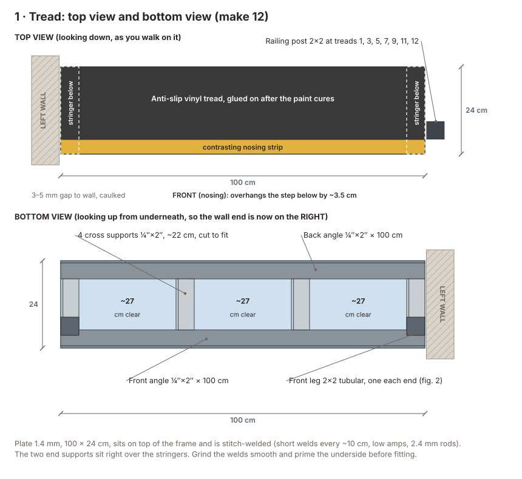
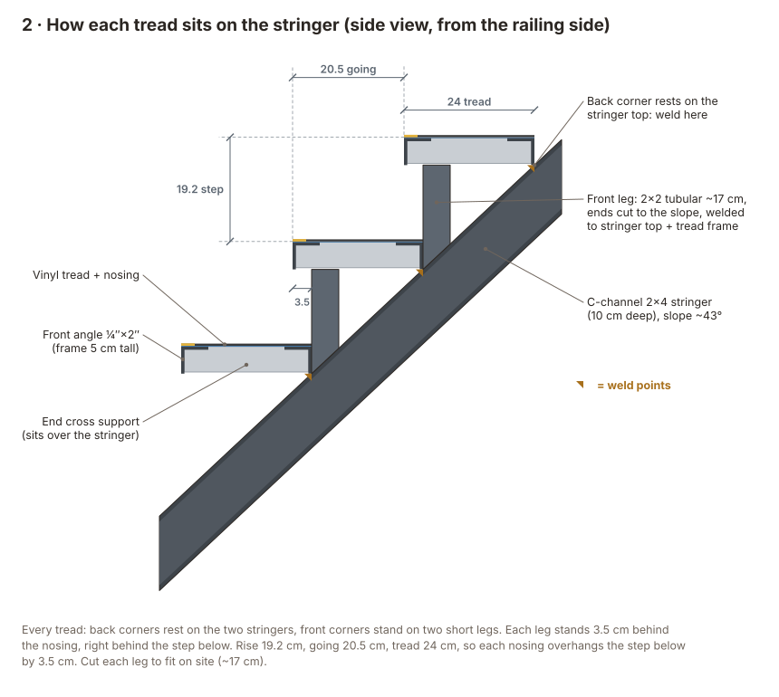
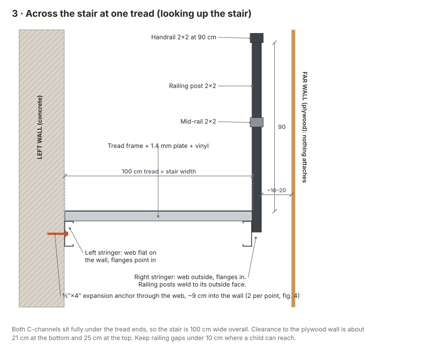
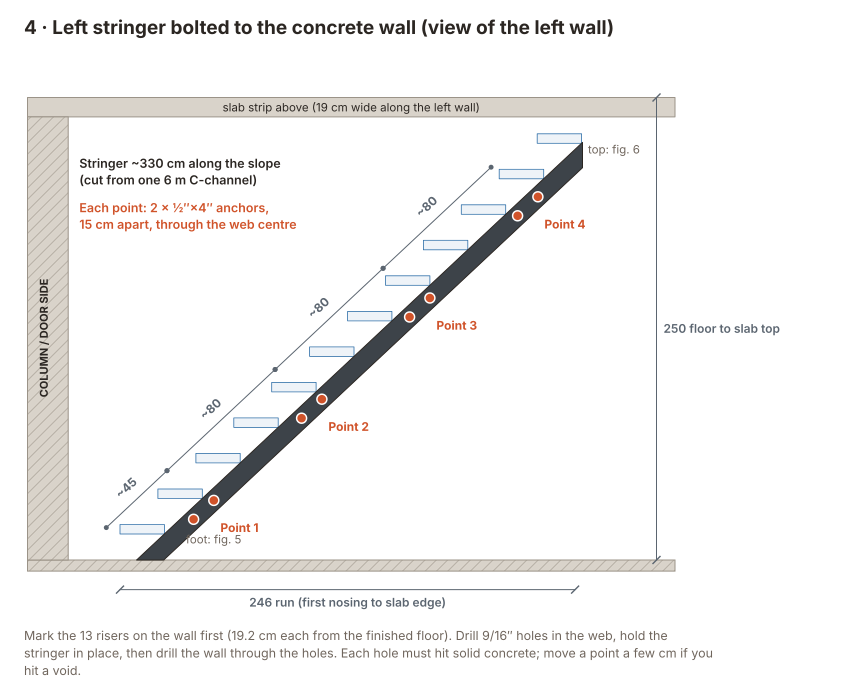
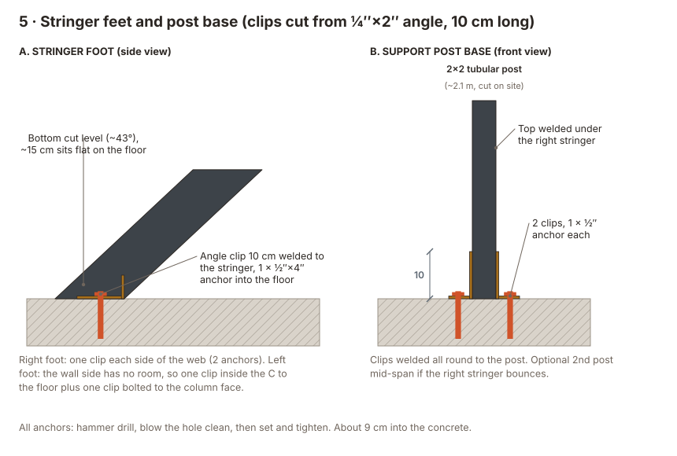
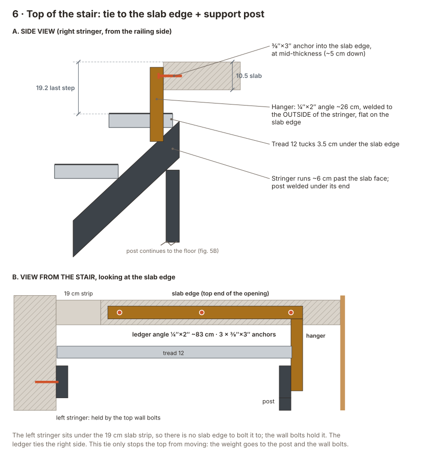

All measurements are in cm unless marked. Steel: ¼″×2″ angle bar, 2×4 C-channel, 2×2 tubular (1.5 mm), 1.4 mm plate. Final sizes are checked and cut on site.

## 1. Tread (make 12)

Top view (as you walk on it) and bottom view (looking up from underneath). Tap any drawing to open it full size and zoom in.

## 2. How each tread sits on the stringer

The back corners rest on the stringers. The front corners stand on short 2×2 legs (~17 cm) welded to the stringer top. Tread 1's front legs stand on the floor (~14 cm).

## 3. Across the stair

## 4. Left stringer bolted to the wall

## 5. Stringer feet and post base

## 6. Top of the stair

## Extra pieces these details need

All come from steel already bought (spare after the main cut list).

| Piece | Material | Qty | Length each |
|---|---|---|---|
| Tread front legs | 2×2 tubular | 24 | ~17 cm (tread 1: ~14 cm) |
| Foot and post clips | ¼″×2″ angle | 6 | 10 cm |
| Top ledger | ¼″×2″ angle | 1 | ~83 cm |
| Top hanger | ¼″×2″ angle | 1 | ~26 cm |

About 4.2 m of tubular (≈13 m spare) and 1.7 m of angle (≈3 m spare).

## Check with the engineer before welding

- **Tread mounting:** the plan doesn't show how treads attach. This page suggests back corners on the stringer and front corners on short legs. Confirm the welder agrees.
- **1.4 mm plate:** spans about 27 cm between supports. Check it doesn't dent or sound hollow ("tin can").
- **Right stringer:** held only by the floor clips and one post at the top, over about 3.3 m. Measure the C-channel thickness and ask if a mid-span post is needed.
- **Slab edge tie:** the ⅜″ anchors leave only about 5 cm of concrete above and below in a 10.5 cm slab. Confirm this is OK as a light tie only (no weight on it).
- **Wall anchors:** 4 points × 2 anchors carry the whole left side. Confirm the spacing and that the wall is solid concrete at each point.
